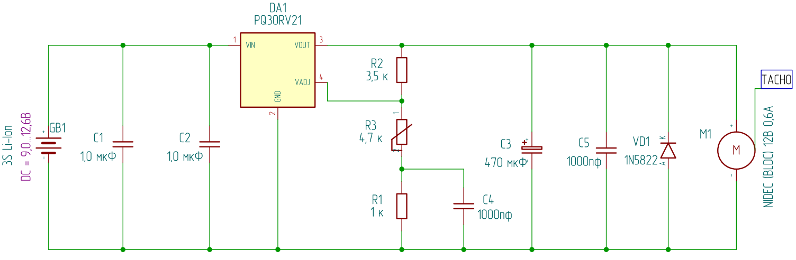

# Portable Vacuum Unit

Battery-powered vacuum pump on a Nidec 12V BLDC motor: manual speed control,
3S Li-Ion pack, compact DIY build.

**Status:** Status: v0.1 — assembled, verified, video attached. Next: v2 (INA3221 + ESP32 + ip2366).

## Demo

https://github.com/user-attachments/assets/faaa4c4b-80e8-4265-8f0d-c4ae3ed239fa

## What it is

A self-contained unit that runs a [Nidec (12V/0.6A) BLDC vacuum pump](datasheet/nidec_00h623n090_en.pdf) from a
3S Li-Ion battery (3×18650, 20A BMS). Pump speed is set with a potentiometer;
the [tacho](datasheet/BLDC_FG_Tachometer_Manual_EN.pdf) output lets you verify the pump is spinning. v0.1 uses a 
[Sharp PQ30RV21](datasheet/Low_Power-Loss_Voltage_Regulators_PQ30RV1PQ30RV11PQ30RV2PQ30RV21.pdf) LDO as the regulator — simple, but inefficient (see Known Issues).
v2 will switch to a buck converter.

## Quick start

1. Connect the 3S battery to `VIN` / `GND`.
2. Turn the potentiometer up: the pump starts reliably above ~6.5V on `VADJ`.

## Wiring

1. Battery (+/−) → `VIN` and common `GND` of the PQ30RV21.
2. `VOUT` → 1N5822 diode → 470 µF capacitor → pump (+).
3. Voltage divider on `VADJ` sets the 5.6–11.5V range
   (R1 = 1kOhm, R2 = 3,5kOhm).
4. Pump tacho (yellow wire) → 10k pull-up → controller / measurement input.

## Measured performance

- Max vacuum, kPa: -97.5;
- Nominal (DC=12V), prm = 66;
- Minimal (DC=12V), rpm = 44;
- Runtime  3S(18650): 
  9V = n/d;
  12V = n/d.

Полная версия BOM и проект KiCad — в репозитории:
- [KiCad project](schematic/) — schematic and PCB files
- [BOM (CSV)](schematic/Portable_Vacuum_Unit.csv)
- [Datasheets](datasheet/) — pump and regulator PDFs

## Known issues (v1)

- The LDO burns the surplus voltage as heat: the pack drains fast and the
  heatsink gets hot. Monitoring is mandatory.
- No thermal protection, no low-battery cutoff.

## Roadmap (v2)

- [ ] v0.1 — analog prototype, verified.
- [ ] Replace the LDO with a buck converter (efficiency).
- [ ] Enclosure (3D-printed).
- [ ] Battery gauge.
- [ ] v2 — IP2366 (charging), INA3221 (monitoring), ESP32 (control:timer, monitoring power, loss time, up-time, IPSLed Display, WI-FI, etc.).

## License

Distributed under the MIT. See `LICENSE` for details.
